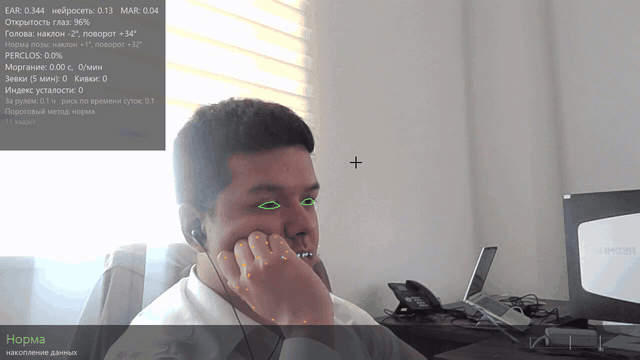
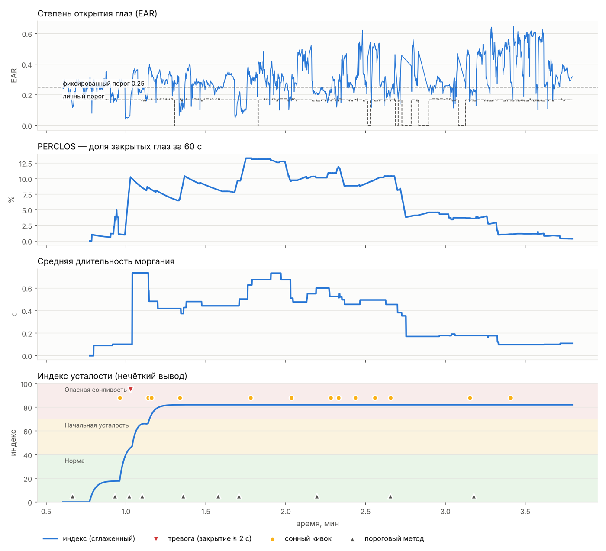

# Real-time Driver Fatigue Detection from Video

[Русская версия](README.ru.md)

A Python system that analyzes a webcam stream or a video file and decides in real time
whether a person is **alert**, **getting tired** or **dangerously drowsy**. It tracks
478 facial landmarks, measures eye closure, blinking, yawning and head nods, and combines
them with fuzzy logic into a fatigue index from 0 to 100.

Built as the prototype for my Master's thesis on AI-based assessment of a person's state
from video (Tajik National University).

**Stack:** Python, OpenCV, MediaPipe (Face Landmarker, Hand Landmarker), NumPy, pandas, matplotlib.



*Live webcam demo (2x speed): the level goes from Normal to Early fatigue, then a yawn and
a 2-second eye closure trigger the alarm and the Dangerous drowsiness level. The interface
is in Russian.*



*A test session with simulated fatigue: eye openness (EAR) with the personal and fixed
thresholds, PERCLOS, average blink duration and the fatigue index with nods, alarms and
the results of the classic threshold method. Chart labels are in Russian.*

## Key features

- **Real-time analysis** of a webcam or a video file (phone recordings work offline).
- **Personal calibration:** the system learns the driver's own open and closed eyes,
  so it works the same for wide and narrow eyes.
- **Fuzzy inference (Mamdani)** with a 0–100 fatigue index and three levels:
  0–40 normal, 40–70 early fatigue, 70–100 dangerous drowsiness.
- **Safety rule:** eyes closed for 2 seconds or more trigger an immediate alarm with sound.
- **Robust to real driving conditions:** changing posture, squinting, head turns,
  sneezing, a hand near the face (second neural network), night and long drives.
- **Driver profiles:** calibrate once, then start monitoring without the calibration step.
- **Session logs and charts:** every frame's features are saved to CSV, with charts and
  batch processing of many recordings.
- **Baseline comparison:** a classic threshold method (EAR < 0.25 for longer than 1.5 s)
  runs in parallel so the two approaches can be compared.

## Installation

Requires Python 3.10–3.12.

```bash
git clone https://github.com/Saddamjon/fatigue-detection.git
cd fatigue-detection
python -m venv .venv
.venv\Scripts\activate        # Windows
source .venv/bin/activate     # macOS / Linux
pip install -r requirements.txt
```

On the first run the program downloads the MediaPipe models `face_landmarker.task`
(about 3.6 MB) and `hand_landmarker.task` from Google. After that no internet is needed.

## Usage

```bash
python main.py                                  # webcam
python main.py --source 1                       # another camera
python main.py --source video.mp4               # video file
python main.py --source video.mp4 --no-display  # fast analysis without a window
python main.py --profile Alex                   # use or create a driver profile
python main.py --unwell                         # higher sensitivity ("feeling unwell" mode)
python main.py --source night.mp4 --start-time 03:00 --hours-driven 3   # driving context
```

Options for comparing algorithm versions: `--no-calib`, `--no-closed-calib`,
`--eye-mode ear|blendshape|fused`, `--no-adapt`, `--no-hand-check`, `--no-context`.

**Calibration (webcam):** sit as you normally sit while driving for 30 seconds, then close
your eyes between two beeps (3 seconds). For video files the program finds the
eyes-closed moment in the recording automatically.

**Keys:** `Q` / `Esc` quit, `C` recalibrate, `S` screenshot, `U` "feeling unwell" mode.

Session chart:

```bash
python plot_session.py logs/session_YYYYMMDD_HHMMSS.csv
```

Batch processing of recordings listed in `sessions.csv` (see `sessions_example.csv`):

```bash
python batch_analyze.py --profile Alex --compare
```

Results go to `results/`: per-session summary, averages by condition and charts.

## How it works

1. **Per-frame features:** EAR (eye aspect ratio), the neural network's blink score
   (`eyeBlink` blendshape), MAR (mouth opening), head pitch, yaw and roll.
2. **Two-point personal calibration:** eye openness is measured inside the person's own
   range (0 closed, 1 open); eyes count as closed below 50%. EAR and the neural score are fused.
3. **Events:** blink, long eye closure (≥ 0.5 s), yawn (mouth open ≥ 1 s), nod.
   Eyes are not evaluated during a yawn or a strong head turn.
4. **Time windows:** PERCLOS and average blink duration over 60 s; yawns and nods over 5 min.
5. **Fuzzy inference:** a fatigue index from 0 to 100; the more dangerous conclusion wins.
6. **Smoothing and hysteresis:** the level changes only if it holds for 3 s.
7. **Safety rule:** eye closure ≥ 2 s raises the alarm immediately.

### Adapting to real driving

| Situation | What the algorithm does |
|---|---|
| Driver leans back or changes posture | If the head stays still in a new position for 10 s with open eyes, this becomes the new normal posture, not a nod |
| Sleepy nod | Detected as a movement: the head slowly drifts away (≥ 0.4 s) and quickly returns (≤ 0.8 s) |
| Head tilted up or down | Normal eye openness is learned separately for each head angle (5° bins) |
| Squinting (sun, habit) | The neural network's `eyeSquint` score is used; EAR is ignored while squinting |
| Head turned > 30° | Only the neural score is used; > 60° eyes count as not visible |
| Sneezing, coughing | Short eye closures (< 1.5 s) with a head jerk are ignored |
| Hand over eyes, mouth or nose | A second network (Hand Landmarker) detects the hand and marks frames correctly |
| Asleep with mouth open | Mouth open longer than 6 s is no longer treated as a yawn |
| Head falls out of the frame | Eye closure timing continues, so the alarm still fires |
| Night, long drive | Time of day and driving time only strengthen facial signs; after 2 h a break is suggested |

Artifact filters never disable the safety rule: they only drop short closures.

## Project structure

| File | Purpose |
|---|---|
| `features.py` | MediaPipe face landmarks; EAR, MAR, head angles and blink scores |
| `fuzzy.py` | Mamdani fuzzy inference: membership functions, rules, centroid |
| `decision.py` | Calibration, event detection, time windows, smoothing, safety rule |
| `config.py` | All thresholds and parameters in one place |
| `main.py` | Video stream, on-screen display, CSV log, session summary |
| `plot_session.py` | Charts of EAR, PERCLOS, blink duration and fatigue index |
| `batch_analyze.py` | Batch processing of recordings and comparison of methods |

## Privacy

The system works fully offline. Video is processed on the device and is not stored or sent
anywhere; only numeric features and decisions are logged. A frame is saved only when you
press `S` for a screenshot.

## Limitations

This is a research prototype, not a certified driver monitoring system. Thresholds may need
tuning in `config.py` for glasses, poor lighting or unusual camera positions.

The Russian README also contains the self-testing protocol used to collect data for the thesis.
